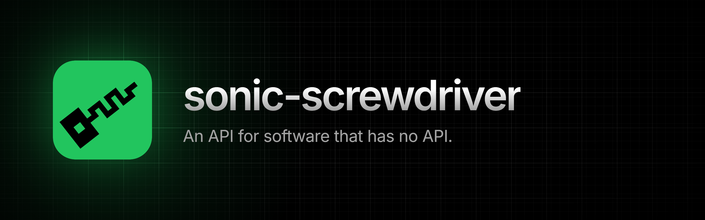

<p align="center">
  
</p>

<p align="center">
  <a href="LICENSE"></a>
  <a href="sdk"></a>
  
  <a href="https://app.sonicscrew.click"></a>
  <a href="https://github.com/L42ARO/sonic-screwdriver/stargazers"></a>
  <a href="https://github.com/L42ARO/sonic-screwdriver/commits/main"></a>
</p>

<p align="center">
  <a href="compute-box"></a>
  <a href="local-agent"></a>
  <a href="sdk/python"></a>
  <a href="sdk/typescript"></a>
  
  
  
  
</p>

<p align="center">
  <a href="https://app.sonicscrew.click"><b>Try it hosted</b></a> ·
  <a href="#quick-start">Quick start</a> ·
  <a href="#run-everything-yourself">Self-host</a> ·
  <a href="sdk">SDKs</a> ·
  <a href="#license">License</a>
</p>

---

**sonic-screwdriver turns a desktop program that has no API into one you can call from
code.** You describe a task as a typed function, such as "look up patient P-1004". An AI
agent then carries it out on the real program, the way a person would: it looks at the
screen and uses the mouse and keyboard.

It doesn't use accessibility trees, database access or other shortcuts. That's the point:
it's made for the 1998 records program, the vendor tool with no export, the app only a
human at the front desk can drive.

```python
from pydantic import BaseModel
from sonic_screwdriver import Sonic

clinic = Sonic(project="demo-project", machine="demo-machine")

class Patient(BaseModel):
    found: bool
    first_name: str | None = None
    phone: str | None = None

@clinic.operation
async def look_up_patient(patient_id: str) -> Patient:
    """Find a patient in DentaSoft by Patient ID and read their record."""

await clinic.sync()                          # once, at startup
patient = await look_up_patient("P-1004")    # an agent does it on the clinic's PC
```

The signature is the input and the return type is the output. The docstring tells the
agent what to do. The function body never runs. The same works in
[TypeScript](sdk/typescript) (Zod schemas) and [Go](sdk/go) (structs).

## How it works

```
 your backend (Python / TypeScript / Go SDK)
        │  HTTPS: sync operations, run one, progress streamed (SSE)
        ▼
 compute-box (Go) ───────── OpenAI (the brain: decides every click)
        │  WebSocket, opened outbound by the agent (no inbound ports)
        ▼
 SonicScrew Local Agent (Rust) on the Windows PC
        │  screenshots in, mouse and keyboard out
        ▼
 the legacy program
```

| Piece | Role |
|---|---|
| **[compute-box](compute-box)** | The server. It holds projects, operations, machines and API keys, runs the model loop, and has a web dashboard with jobs, step-by-step screenshots, a playground and spend tracking. It runs on SQLite, in a single Docker container. |
| **[local-agent](local-agent)** | The hands and eyes: a small Windows tray app that takes screenshots and clicks and types exactly as told. It has no AI of its own. It connects outward with a per-machine token and updates itself with signed releases. |
| **[sdk](sdk)** | Python, TypeScript and Go clients: operations as typed functions, input and output validation, streamed progress, stable error codes. |
| **[test-target](test-target)** | Fake legacy apps to practise on: DentaSoft (dental records) and StockPilot (inventory). |
| **[test-source](test-source)** | Sample clinic backends in all three languages that call DentaSoft through the SDKs. |
| **[evals](evals)** | Repeatable end-to-end runs that measure success rate, time and cost. |

## Features

- **Vision only.** It works with any Windows program, however old, with no integration
  on the program's side.
- **Typed operations.** Inputs and outputs are validated on both ends, and results come
  back as structured data, not text.
- **Programs and machines.** A project names the programs it uses, and each machine says
  where they're installed. The agent opens, finds and focuses windows as needed.
- **Safe by default.**
  - Machine tokens work only for their own machine and can be revoked one at a time.
  - Each user has a model spend cap.
  - An on-screen "agent at work" overlay shows while a job runs.
- **Observable.** Every job keeps its steps, screenshots, tokens and cost, and you can
  watch them live in the dashboard.
- **Self-updating agent.** Agent updates are signed with the project's release key. The
  agent asks before installing one and waits until no job is running.

## Quick start

The fastest path is the hosted service at **[app.sonicscrew.click](https://app.sonicscrew.click)**:

1. Sign in with GitHub and follow the checklist on the Overview page.
2. Download the **SonicScrew Local Agent** from the
   [latest release](https://github.com/L42ARO/sonic-screwdriver/releases/latest). Run it,
   keep the machine name `demo-machine`, and paste the machine token from the dashboard.
3. Add the demo project from the checklist and run an operation from the
   **Playground**. You can also create an API key and call it from one of the
   [sample backends](test-source).

## Run everything yourself

Requirements: Windows, Go, Rust and Python 3, plus an OpenAI key.

```powershell
# 1. compute-box. In compute-box/.env set OPENAI_KEY=... and SONIC_OWNER_PASSWORD=...
cd compute-box; go run .
# Open http://localhost:8080 and sign in. Add the machine "demo-machine" (copy its token)
# and create an API key (copy it). Each is shown only once.

# 2. The agent, on the Windows machine
cd local-agent; cargo build --release
.\target\release\SonicScrew-Local-Agent.exe
# In setup: URL http://localhost:8080, machine name demo-machine, and the machine token.

# 3. A sample backend. On startup it registers the project, the machine and DentaSoft.
cd test-source\python-clinic-backend
$env:SONIC_URL = "http://localhost:8080"
$env:SONIC_API_KEY = "sonic_sk_..."
$env:DENTASOFT_SCRIPT = "$PWD\..\..\test-target\dentasoft\dentasoft.py"
.\.venv\Scripts\uvicorn main:app
curl http://localhost:8000/patients/P-1004
```

- Don't touch the mouse or keyboard while the overlay is showing.
- To test the plumbing without a model, start the compute-box with `SONIC_BRAIN=scripted`.
- DentaSoft's login is `drsmith` / `molar123`.
- If you forget the dashboard password, `go run . login-link` prints a one-time sign-in
  link.

**On a server:** the compute-box ships as a Docker image. Run `docker compose up` in
`compute-box/`. [The compute-box README](compute-box/README.md#docker-self-hosting) covers
sign-in, tokens, settings (including `SONIC_BUDGET_USD`, the per-user spend cap) and the
data volume.

<details>
<summary><b>Where everything is</b></summary>

| Path | What it is |
|---|---|
| `compute-box/` | Go server: caller API, agent hub, job queues, OpenAI brain, budgets, dashboard |
| `compute-box/README.md` | Settings, API, how a job runs, caching and cost, Docker |
| `local-agent/` | Rust agent: screen, mouse and keyboard; tray app; updates |
| `local-agent/README.md` | Action list, CLI, overlay, coordinates, updates |
| `sdk/python/`, `sdk/typescript/`, `sdk/go/` | The SDKs |
| `test-source/*-clinic-backend/` | The same clinic backend in Python (FastAPI), TypeScript (Express + Zod) and Go |
| `test-target/dentasoft/` | DentaSoft, a fake 1998 dental records program (Tkinter, deliberately laggy) |
| `test-target/stockpilot/` | StockPilot, a fake inventory program |
| `evals/` | End-to-end evaluation suites: `python evals/run.py dentasoft --cold-start` |

</details>

## Design decisions

- **Vision only.** The agent never reads UI Automation or accessibility trees, so it
  handles anything a person can see.
- **Windows first.** Each machine has one agent. A person can watch, and pause the agent
  from the tray.
- **The model sits behind our own tools.** The agent's actions are our own tool
  definitions, so the agent stays the same whatever model drives it. OpenAI is the
  provider today.
- **Operations live in your code.** They're declared next to the code that calls them
  and synced per project, and every run streams its progress over Server-Sent Events.

## Roadmap

- [x] Vision agent that drives any Windows program with screenshots, mouse and keyboard
- [x] Typed operations from Python, TypeScript and Go SDKs
- [x] Dashboard with jobs, step-by-step screenshots, playground and spend tracking
- [x] Per-machine tokens, per-user spend caps and Docker self-hosting
- [x] Hosted service at [app.sonicscrew.click](https://app.sonicscrew.click)
- [x] Signed, in-place updates for the agent
- [ ] A stop button or hotkey on the agent, so a person can halt a job at any moment
- [ ] An MCP server, so developers can set up projects, machines and operations from their AI coding tools
- [ ] Data migration: use the agent to extract records from old software that has no API
      or export, to move them into a new system
- [ ] Recording and replaying click paths, to cut the time and cost of repeated operations
- [ ] A generated OpenAPI spec and a `sonic` CLI

## License

- The compute-box, local-agent, examples, test targets and evals are under the
  [GNU Affero General Public License v3.0](LICENSE). If you distribute modified versions,
  or let others use them over a network (for example as a hosted service), you must
  publish your changes under the same license.
- The SDKs in [`sdk/`](sdk) are under the [Mozilla Public License 2.0](sdk/go/LICENSE).
  Changes to the SDK files themselves must be shared. Applications that use the SDKs can
  be under any license, including proprietary.
